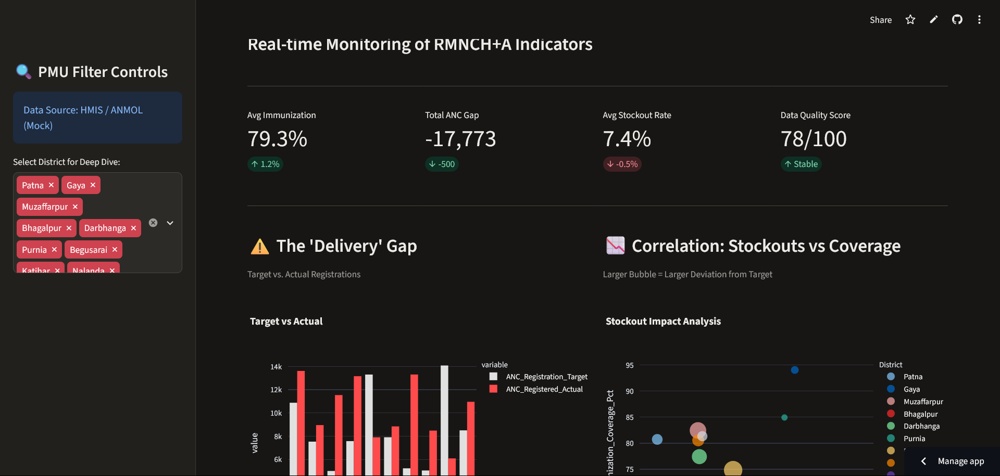

# Bihar Health KPI Dashboard

A Streamlit-based dashboard designed for a Program Management Unit (PMU) to monitor RMNCH+A health indicators across districts.

**Live demo:** [open it](https://YOUR-STREAMLIT-URL-HERE.streamlit.app/)

## 1. The problem

Health program managers need to quickly spot districts that are falling behind on targets (like ANC registrations or immunization coverage) and correlate those gaps with operational issues (like medicine stockouts). Reviewing raw HMIS data in Excel is slow and doesn't highlight the relationships between different metrics.

## 2. What it does

- Interactive **sidebar filters** to select specific districts.
- **Top-level summary cards** showing average immunization, total ANC gap, and average stockout rates.
- **Target vs. Actual Bar Chart:** Spotlights districts missing their ANC registration targets.
- **Scatter Plot (Stockout vs. Coverage):** Correlates medicine stockouts with immunization coverage. The bubble size represents the absolute deviation from the ANC target.
- **Data Table:** Raw district data available in an expander for forensic auditing.

## 3. How I built it: AI tool, prompts, manual work

Built with **Gemini and Claude**. 

Prompts that mattered:
- *"Create a Streamlit dashboard for district health data. Generate mock data using numpy and pandas for 10 districts."*
- *"Add a sidebar multiselect filter for districts, summary metric cards, a grouped bar chart for targets vs actuals, and a scatter plot for stockouts vs coverage."*

**What I fixed by hand:**
The AI wrote the initial scatter plot, but it crashed immediately when I ran it. I had to manually debug the code. If you look at the `load_data()` function in `Dashboard_Bihar.py`, you will see this comment: 
`# --- THE FIX: Create an Absolute Value column for Plotly Size ---` 
Plotly cannot map a negative number to a bubble size. I created a `Gap_Magnitude` column using `.abs()` so the chart could render without throwing a `ValueError`.

## 4. How to try it

The live demo is hosted on Streamlit Community Cloud. Because it uses randomly generated mock data, the exact numbers will change every time the app reloads, but the layout and interactions remain the same.

To run it locally:
1. `pip install streamlit pandas numpy plotly`
2. `streamlit run Dashboard_Bihar.py`

## 5. Classroom angle

An excellent exercise for teaching data visualization pipelines in Python. The classroom prompt: *"Swap the `load_data()` function to read a real CSV file instead of `np.random`. Then add one new KPI card for 'Data Quality Score'."* This teaches students how to decouple data ingestion from the UI layer.

## Limitations / next steps

- **Mock data only:** Currently generates random data on every reload. Next step is connecting to a real database or CSV.
- **No authentication:** In production, a health dashboard containing sensitive district data would require SSO or a login gate.

