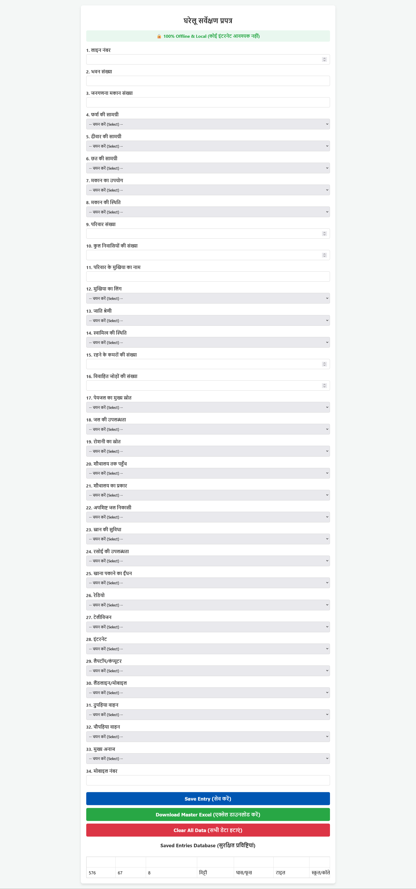

# Census 2026 Offline App

A 34-field household survey form designed to work entirely offline. It saves entries to the browser's local storage and exports a master CSV when the field worker gets back online.

**Live demo:** [open it](https://varunbalotia.github.io/ai-builds-portfolio/census-offline-app/Census_2026.html)

## 1. The problem

Field surveys (like census or health data collection) often happen in areas with poor or no internet connectivity. Standard cloud-based forms (like Google Forms) fail when the signal drops. Workers need a tool that works on a phone or laptop without a connection, doesn't lose data if the page refreshes, and can easily export all the collected data to Excel at the end of the day.

## 2. What it does

- **34 data fields** based on census/household survey standards (housing materials, water access, assets).
- **Hindi UI** for local field workers.
- **100% Offline:** Uses browser `localStorage`. No server, no database, no internet required after the page initially loads.
- **Data Grid:** Displays saved entries immediately below the form.
- **Master Export:** Generates a UTF-8 encoded CSV file (with a BOM so Excel opens it correctly in Hindi) containing all saved records.
- **Clear Data:** A safety-button to wipe local memory once the CSV is exported.

## 3. How I built it: AI tool, prompts, manual work

Built with **Gemini and Claude**. 

Prompts that mattered:
- *"Generate an HTML/JS form with 34 specific survey fields in Hindi. Use localStorage to save records so it works offline, and display them in a table below the form."*
- *"Add a button to export the saved localStorage data to a CSV file."*

What I fixed by hand: 
- **Excel & Hindi:** The exported CSV was producing garbled Hindi characters in Excel. I manually added the UTF-8 Byte Order Mark (`\uFEFF`) to the CSV string, which forces Excel to read it correctly.
- **Data validation:** Added a manual check to ensure the line number (`f1`) isn't blank before saving.
- **Scrolling:** The table container needed a manual `max-height` and `overflow-x: auto` CSS fix so the page doesn't get infinitely long when 50+ entries are saved.

## 4. How to try it

Open the live demo. Fill out a few fields and click **Save Entry**. Refresh the page — your entry is still there. Click **Download Master Excel** to see the CSV output. 

## 5. Classroom angle

An instructor can use this to teach **state management** and **browser storage** to beginners in one session. The exercise: have students change the `const fields` array to add a new question (e.g., "Number of smartphones"). They will see how one change in the data array automatically updates the form UI, the table headers, and the CSV export. 

## Limitations / next steps

- **No backup:** Because data is in `localStorage`, clearing browser data will erase the records. A real production app would need a background sync to a database (like IndexedDB + Sync API).
- **Single device:** Data cannot be aggregated across multiple field workers without manually merging the CSVs.

