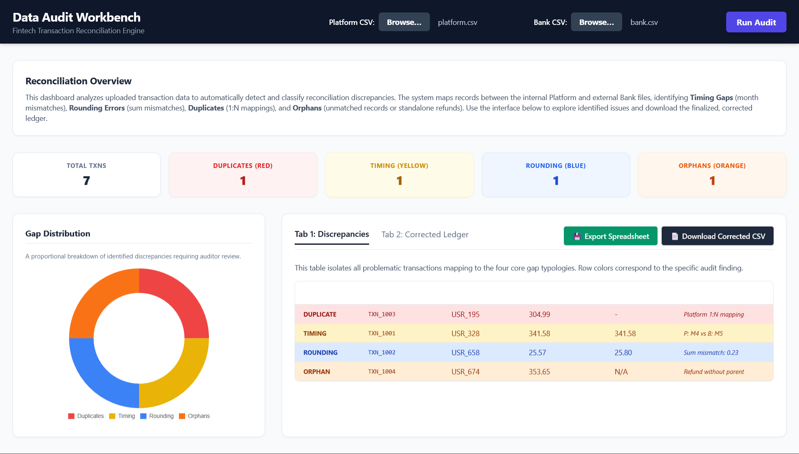

# Payment Reconciliation Dashboard

Upload a platform CSV and a bank CSV; the dashboard matches transactions, classifies every discrepancy into one of four gap types, and exports a corrected ledger.

**Live demo:** [open it](https://varunbalotia.github.io/ai-builds-portfolio/payment-reconciliation/Dashboard.html)

## 1. The problem

Finance and ops teams reconcile two exports — the platform's transaction log and the bank's settlement file — by hand in Excel. The failure modes are always the same four: duplicated rows, month-boundary timing gaps, small rounding differences, and orphan records (a refund with no parent transaction, or a bank line missing from the platform). Doing this manually is slow and the errors are easy to miss.

## 2. What it does

- Accepts two CSVs, parsed in-browser with PapaParse — **no upload, no server, no keys**
- Matches on `transaction id` and classifies gaps:

| Gap type | Detection rule | Colour |
|---|---|---|
| Duplicate | same `transaction id` appears more than once on either side (1:N) | Red |
| Timing | platform and bank timestamps fall in different months/years | Yellow |
| Rounding | absolute value difference is > 0 and < 2.00 | Blue |
| Orphan | present on one side only; refunds without a parent are flagged separately | Orange |

- Summary cards + a donut chart of gap distribution
- **Tab 1:** every discrepancy, colour-coded by type, with the audit detail
- **Tab 2:** the reconciled ledger — duplicates collapsed, timing/rounding overridden with the bank as source of truth, orphans flagged
- Exports a two-sheet `.xlsx` (SheetJS) and a corrected `.csv`

## 3. How I built it: AI tool, prompts, manual work

Built with **Gemini and Claude**. The planning comments preserved at the top of `Dashboard.html` are the structure plan produced with the AI before any code was written — palette choice, page layout, viz library selection, and an explicit constraint ("no SVG, no Mermaid") that the AI then respected.

Prompts that mattered:
- *"Design a single-page reconciliation dashboard: file uploads in the header, summary cards, donut chart for gap distribution, tabbed tables for discrepancies and corrected ledger. No SVG, no Mermaid."*
- *"Write a matching engine that classifies duplicates, month-boundary timing gaps, sub-2.00 rounding differences, and orphans. Refunds with no parent are orphans."*
- *"Export must produce a two-sheet xlsx plus a corrected CSV."*

What I fixed by hand: the rounding rule's threshold (a bare `!=` flagged every cent of noise, so it's bounded at 2.00), the refund-without-parent case being reported as an orphan rather than a plain unmatched row, and the sticky table headers so long ledgers stay readable while scrolling.

## 4. How to try it

Open the live demo, or run locally: download `Dashboard.html` and double-click it — no build step. Upload `sample_data/platform.csv` and `sample_data/bank.csv` and click **Run Audit**. You should see exactly 1 duplicate, 1 timing gap, 1 rounding gap and 1 orphan.

## 5. Classroom angle

A one-session exercise for non-technical instructors: students upload the two sample CSVs, then write the duplicate-detection rule themselves in the browser console and watch the discrepancy table change. Teaches CSV parsing, key-based matching, and why "bank is source of truth" is a policy decision, not a technical one — about 45 minutes, no backend, no accounts.

## Limitations / next steps

- No database: state lives in the browser tab and resets on reload
- Matching is exact on `transaction id`; fuzzy matching on amount+date is not implemented
- The 2.00 rounding threshold is a heuristic, not a rule from any spec
